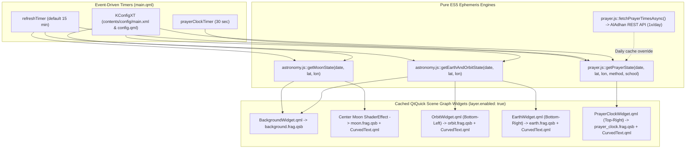

# Moon Phase & Celestial Astrolabe Wallpaper for KDE Plasma 6

A live, physically based astronomical desktop wallpaper for **KDE Plasma 6** (`org.kde.plasma.moonphase`). It combines a real-time Jean Meeus lunar and solar ephemeris engine with five custom GLSL 440 fragment shaders and NASA elevation/bathymetry datasets to turn the desktop into a cohesive celestial observatory.

---

## 1. Visual Components & Features

### Center: Physically Based 3D Moon (`main.qml` + `moon.frag`)
- **Jean Meeus Ephemeris (Ch. 47/48):** True lunar phase angle, illuminated fraction, synodic age, selenocentric sun direction, and **optical libration** in longitude and latitude (the Moon visibly wobbles across the month).
- **LRO Elevation & Normal Mapping:** Uses `2048×1024` equirectangular lunar maps (`moon_albedo.jpg` and `moon_normal.png`) derived from NASA's Lunar Reconnaissance Orbiter (LRO) CGI Moon Kit (`ldem_4.tif` + `lroc_color_poles_2k.tif`).
- **Hapke / Lommel-Seeliger + Lambert Regolith BRDF:** Soft solar terminator with realistic limb brightening, micro-shadowing across crater rims, and configurable **Earthshine** illuminating the night hemisphere.
- **Invariant Centering & Curved Telemetry Arc (`CurvedText.qml`):** The lunar disc is locked to `anchors.centerIn: parent` so toggling captions never shifts the Moon. Its curved telemetry caption (`WANING GIBBOUS • 61.9% • DAY 9.0`) follows a circular bottom arc outside the `r = 0.265` ticked astrolabe bezel with an automatic radial-spoke keepout zone.

### Full-Screen Backdrop: Switchable Celestial Planisphere & Engraved Seasonal Etchings (`BackgroundWidget.qml` + `background.frag`)
- **Razor-Sharp Screen-Space Anti-Aliased Geometry:** Uses `fwidth(r)` screen-space derivatives (`crispStroke`) for 1-pixel anti-aliased concentric coordinate rings, 72/120-tick lunar bezel graduation marks, and constellation lines with zero Gaussian blur.
- **Mid-Vertical Constellation Placement:** Seasonal zodiac and major constellations (Orion, Cygnus, Cassiopeia, Leo) are scaled and positioned in the vertical mid-band (`y ∈ [0.36, 0.64]`) so they never collide with the corner instruments.
- **Three User-Switchable Styles (`SeasonalBackgroundStyle`):**
  - `0 = Star Chart (Planisphere & Constellations)`: Rotating equatorial star catalog, seasonal constellations, right-ascension/declination circles, and ecliptic degree ticks.
  - `1 = Seasonal Wireframe Etchings (Astrolabe)`: Fine watchmaker-style vector line-art corners that morph across the 4 observer seasons (Winter geometric snowflakes, Spring botanical blossoms, Summer horizon clouds/arcs, Autumn falling leaves).
  - `2 = Combined`: Renders both the celestial star chart and the seasonal wireframe etchings together.

### Bottom-Left: Flat Top-Down Heliocentric Astrolabe Orbit (`OrbitWidget.qml` + `orbit.frag`)
- **Top-Down Ecliptic Planisphere:** Circular astrolabe plate with degree ticks, cardinal equinox/solstice crosshairs (`MAR`, `JUN`, `SEP`, `DEC`), an inner `JAN 1` anchor pin, and a central solar emblem.
- **Live Heliocentric Progress & Curved Telemetry:** Swept golden arc from `Jan 1` counter-clockwise to the current day of the year, four hollow equinox/solstice station rings, a glowing active Earth reticle, and a curved bottom telemetry arc (`AUTUMN • DAY 292 / 365 • 79.7%`).

### Bottom-Right: Topographic & Bathymetric Observer-Centered Earth Globe (`EarthWidget.qml` + `earth.frag`)
- **Lunar-Matched Lithographic Aesthetic:** Styled to match the Moon's muted monochrome/slate palette (`earth_day.png`, `earth_night.jpg`, and `earth_normal.png`).
- **Real NASA GEBCO 08 Topography & Bathymetry Relief:**
  - `earth_normal.png` (`2048×1024 RGB`) encodes tangent-space surface normals computed from merged land elevation (`gebco_08_rev_elev`) and ocean floor bathymetry (`gebco_08_rev_bath`).
  - `earth_day.png` (`2048×1024 RGBA`) encodes muted land/ocean albedo in `RGB` and continuous bathymetric depth (`[0.58..1.00]`) + land elevation (`[0.20..0.48]`) in `Alpha`.
- **Physically Based Day/Night Shading & Curved Telemetry:** Uses the same Lommel-Seeliger + Lambertian diffuse model as the Moon, casting relief shadows across mountain ranges (Himalayas, Andes) and mid-ocean ridges near the solar terminator, plus warm nocturnal city lights (`BlackMarble_2016`), polar ice caps, an observer reticle pin, and a curved telemetry arc (`30.0°N, 31.2°E • SOLAR 21:04`) seated cleanly outside the globe's circumference (`r = 0.560 * width`).

### Top-Right: Dual-Ring Analogue Prayer Times Astrolabe Clock (`PrayerClockWidget.qml` + `prayer_clock.frag` + `prayer.js`)
- **Concentric 12-Hour Rings:**
  - **Inner Ring (`R = 0.245`):** First 12 hours of the day (`00:00 – 12:00`, AM cycle).
  - **Outer Ring (`R = 0.365`):** Second 12 hours of the day (`12:00 – 24:00`, PM cycle).
- **Day/Night + Active/Inactive Color Hierarchy:**
  - **Day Arcs (`Sunrise → 12:00` on inner, `12:00 → Maghrib` on outer):** Solar Yellow (`vec3(0.98, 0.85, 0.45)`).
  - **Night Arcs (`00:00 → Sunrise` on inner, `Maghrib → 24:00` on outer):** Crisp White (`vec3(0.96, 0.98, 1.00)`).
  - **Active Ring (`AM = Inner`, `PM = Outer`):** Full popping opacity (`~0.84`) + swept elapsed-hours arc from `00:00`/`12:00` clockwise to the current time.
  - **Inactive Ring:** Retains the exact same **Solar Yellow** (day) and **Crisp White** (night) colors as the active ring, differentiated by true Porter-Duff premultiplied transparency (`alpha ~ 0.48`).
- **Dual-Ring Clock Hands:**
  - **Hour Indicator:** Glowing white astrolabe bead + precision reticle riding directly on the active ring (`R_inner` in AM, `R_outer` in PM).
  - **Minute Vernier Runner:** Diamond indicator riding in the mid-channel (`R_mid = 0.305`) between the two rings, with its radial pointer spike directed inward toward the inner ring in AM and outward toward the outer ring in PM.
- **Prayer Time Nodes, Vector Astronomical Glyphs & Curved Telemetry:**
  - Plots **Fajr** (dawn rays), **Sunrise** (horizon half-sun), **Dhuhr** (zenith sun), **Asr** (45° shadow sun), **Maghrib** (setting half-sun), and **Isha** (crescent moon + star) radially offset from their respective 12-hour rings, highlighting the next upcoming prayer with a target ring and curved countdown caption (`FAJR 04:32 (-07:29) • 21:02`).
- **Hybrid AlAdhan API + Offline Solar Zenith Engine:**
  - Fetches daily timings from the free AlAdhan REST API (`https://api.aladhan.com/v1/timings/...`) once per day per location/method, and falls back seamlessly to deterministic Meeus solar-zenith math offline across 7 calculation methods (**MWL**, **Umm al-Qura**, **Egyptian**, **ISNA**, **Diyanet**, **Karachi**, **Tehran**) and both **Standard** and **Hanafi** Asr schools.

### Redesigned Settings Dialog (`config.qml`)
- **Your Location:** One-click **City Preset** dropdown (23 world cities across both hemispheres + `Custom Coordinates`) that automatically fills Latitude/Longitude and toggles Southern Hemisphere orientation when `Latitude < 0°`.
- **Center Moon & Labels:** Percentage sliders for Moon size, Crater depth, and Dark-side glow, plus a single toggle for all curved info captions (`ShowTelemetryOverlay`).
- **Background & Star Chart:** Unified style selector (`Star Chart`, `Seasonal Wireframe Etchings`, `Combined`, `Solid Color Only`) with progressive disclosure that hides inactive controls.
- **Corner Instruments:** Each instrument's sub-options are grouped directly under its toggle and automatically hide when that instrument is unchecked.
- **Time-Travel Sandbox & Advanced:** Collapsible simulation mode with an inline warning banner, one-click `Return to Live Time` action, hemisphere-aware season readout, and dual `Local Solar · UTC` time readout.

---

## 2. Software Map & Repository Structure

```text
kde-moonphase-wallpaper/
├── metadata.json                        # KDE Plasma 6 KPackage manifest (org.kde.plasma.moonphase)
├── Makefile                             # Shader baking (qsb), unit tests, headless previews, install
├── README.md                            # Architecture & usage documentation
├── contents/
│   ├── code/
│   │   ├── astronomy.js                 # .pragma library: Meeus lunar & heliocentric Earth ephemeris
│   │   └── prayer.js                    # .pragma library: Solar-zenith prayer calculator + AlAdhan API cache
│   ├── config/
│   │   └── main.xml                     # KConfigXT schema for all user-configurable settings
│   ├── images/
│   │   ├── moon_albedo.jpg              # 2048×1024 RGB : NASA LRO lunar surface albedo map
│   │   ├── moon_normal.png              # 2048×1024 RGBA: NASA LRO tangent-space normal map (RGB) + albedo (A)
│   │   ├── earth_day.png                # 2048×1024 RGBA: Muted Earth albedo (RGB) + GEBCO depth/elev (A)
│   │   ├── earth_night.jpg              # 2048×1024 RGB : NASA Black Marble nocturnal city lights
│   │   └── earth_normal.png             # 2048×1024 RGB : NASA GEBCO topography + bathymetry normal map
│   ├── shaders/
│   │   ├── background.frag   (.qsb)     # Full-screen planisphere star chart & seasonal etchings shader
│   │   ├── moon.frag         (.qsb)     # Center 3D Moon sphere shader (Lommel-Seeliger + LRO normals)
│   │   ├── orbit.frag        (.qsb)     # Bottom-left flat top-down heliocentric astrolabe orbit shader
│   │   ├── earth.frag        (.qsb)     # Bottom-right topographic/bathymetric Earth globe shader
│   │   └── prayer_clock.frag (.qsb)     # Top-right dual-ring analogue prayer times clock shader
│   └── ui/
│       ├── main.qml                     # Root WallpaperItem: timers, ephemeris wiring, center Moon
│       ├── config.qml                   # Redesigned 5-section Kirigami.FormLayout settings UI
│       ├── CurvedText.qml               # Reusable proportional-glyph circular arc telemetry component
│       ├── BackgroundWidget.qml         # Full-screen seasonal background ShaderEffect wrapper
│       ├── OrbitWidget.qml              # Bottom-left astrolabe orbit ShaderEffect + curved telemetry
│       ├── EarthWidget.qml              # Bottom-right Earth globe ShaderEffect + curved telemetry
│       └── PrayerClockWidget.qml        # Top-right prayer clock ShaderEffect + vector symbol Canvas
├── scripts/
│   ├── prepare_assets.py                # Downloads & bakes NASA LRO Moon normal/albedo texture
│   ├── prepare_earth_assets.py          # Downloads & bakes NASA BlueMarble/BlackMarble/GEBCO Earth maps
│   └── earth_assets_provenance.txt      # SHA-256 provenance of all 5 NASA source datasets
└── tests/
    ├── test_astronomy.mjs               # Node unit tests for lunar phase, libration, and syzygies (9 tests)
    ├── test_earth_orbit.mjs             # Node unit tests for solar declination, EoT, seasons (18 tests)
    ├── test_prayer.mjs                  # Node unit tests for prayer zenith math & AlAdhan parser (13 tests)
    ├── shader_smoke.qml                 # Headless OpenGL smoke test for all 5 shaders + procedural maps
    ├── render_preview.qml               # Headless renderer for the 4 principal lunar phases
    └── render_full_wallpaper.qml        # Headless 1920×1080 renderer across all 4 seasons
```

---

## 3. Data Flow & Runtime Architecture



---

## 4. Runtime & Build Requirements

### Runtime Dependencies (End-User Desktop)
- **OS / Desktop:** Linux with **KDE Plasma 6** (`plasmashell >= 6.0`, tested on Plasma 6.8 / Qt 6.12)
- **Qt 6 Modules:**
  - `QtQuick` (`qml6`)
  - `org.kde.plasma.plasmoid` (`WallpaperItem`)
  - `org.kde.kirigami` (`Kirigami.FormLayout`, `Kirigami.InlineMessage`, `Kirigami.Theme`)
  - `QtQuick.Controls` (`Slider`, `CheckBox`, `ComboBox`, `SpinBox`, `DoubleSpinBox`)
- **Installer Tool:** `kpackagetool6` (from `kpackage` / `kf6-kpackage`)
- **Graphics:** OpenGL / Vulkan / Metal via Qt 6 RHI (all `.frag.qsb` packages pre-bake GLSL 100 ES, GLSL 120, GLSL 150+, HLSL 50, and MSL 12)

### Development & Asset-Regeneration Dependencies (Optional)
- **Shader Compiler:** `/usr/lib64/qt6/bin/qsb` (from `qt6-shadertools` / `qt6-shadertools-devel`)
- **Unit Test Runner:** `node` (Node.js >= 18) for `make test`
- **Headless Visual Tests:** `xvfb-run` + `qml6` + `python3` (`Pillow`) for `make smoke`, `make preview`, and `make preview-full`
- **NASA Texture Baker Scripts (`scripts/prepare_*.py`):** `python3` with `numpy`, `scipy`, `Pillow`, and `tifffile`

---

## 5. Installation, Live Reload & Development Commands

```bash
# Install or upgrade the wallpaper into ~/.local/share/plasma/wallpapers/org.kde.plasma.moonphase
make install

# Recompile all 5 GLSL 440 shaders into .qsb packages
make shader

# Run all 40 unit tests (lunar ephemeris + heliocentric orbit + prayer times)
make test

# Run headless OpenGL smoke test across all 5 shaders
make smoke

# Render 4 full 1920x1080 seasonal desktop previews into /tmp/opencode/full_wallpaper/
make preview-full
```

## License

GPL-2.0-or-later. Lunar and Earth textures derive from public-domain NASA LRO, Blue Marble Next Generation, Black Marble, and GEBCO datasets.
