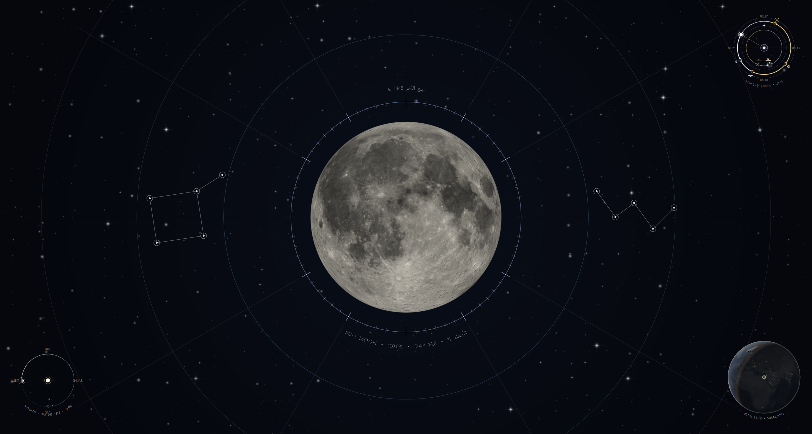

# Moonphase on Windows 11

Native x64 Qt 6/Direct3D 11 host for Hadi Alahmad's Moon Phase & Celestial Astrolabe wallpaper. Windows implementation by **Muhannad Al-Ahmad**. It runs independently of KDE, WSL and third-party wallpaper players.



## Build

Use Windows 11 x64, Visual Studio C++ desktop tools and Windows SDK, CMake 3.24+, Ninja, Python **3.11+**, and Qt **6.8+ MSVC x64** with Qt Quick, Widgets, Network, Svg and Shader Tools. The verified SDK is Qt 6.8.3. Node 18+ enables calculation tests. This source contribution includes no prebuilt executable or SDK.

In an **x64 Visual Studio Developer PowerShell**, with CMake/Ninja/Python on PATH and `QTDIR` pointing to the SDK:

```powershell
./windows/scripts/build.ps1 -QtDirectory $env:QTDIR
ctest --test-dir build/windows --output-on-failure -C Release
```

The executable is `build/windows/Moonphase.exe` (or its `Release/` subdirectory with a multi-configuration generator). The equivalent configure command is `cmake -S windows -B build/windows -G Ninja -DCMAKE_BUILD_TYPE=Release -DCMAKE_PREFIX_PATH="$env:QTDIR"`. Launch a build-tree executable from the Qt development environment, or deploy it first as described below.

The root Makefile remains the Linux/KDE entry point. CMake reads shared `../contents/` directly. Only compatibility copies are generated in the build tree: KDE root/font references become native Qt references, host settings/pause notifications are wired in, and the prayer engine receives the selected timezone. The current packed Moon/Earth textures, render-and-evict caches, Arabic Hijri arcs, calculations and all five shader sources are retained. The adapter validates its textual integration points so incompatible upstream edits fail at configure time.

## Portable deployment

Use a new output directory. No installer or system-wide modifications are needed. Packaging runs `windeployqt` and supplies the C++ runtime from the licensed Visual Studio **REDIST x64 Microsoft.VC14x.CRT** directory. It never takes runtime DLLs from System32 or the compiler's `bin` directory. Use your SDK/REDIST paths as command parameters; no particular installation path is assumed.

Obtain exact corresponding Qt module sources explicitly (or reuse previously verified archives):

```powershell
python windows/scripts/fetch_qt_sources.py --version 6.8.3 --output build/qt-sources
git add windows README.md .gitignore
python windows/scripts/package.py --qt-directory $env:QTDIR `
  --crt-directory $env:MOONPHASE_CRT_DIRECTORY --qt-sources build/qt-sources
```

Set `MOONPHASE_CRT_DIRECTORY` to the CRT directory from your licensed Visual Studio installation; `VCToolsRedistDir` in the developer shell identifies its REDIST parent. The package validates the Qt version and source hashes, includes the tracked/staged application source, Qt source archives, license texts, SPDX notices and asset provenance, and creates `windows/dist/Moonphase-Windows.zip`. Unstaged source edits to tracked files are also captured; `sources/source-state.json` identifies a modified worktree. Stage new source files before packaging. Binary release distributors must follow [THIRD-PARTY-NOTICES.md](THIRD-PARTY-NOTICES.md).

## Use

Extract the complete portable ZIP and double-click **Moonphase.exe**. Right-click its crescent notification-area icon for Start, Stop, Pause, Preview, Settings, optional Start with Windows, fullscreen pausing and Exit. Double-click the icon for settings. Closing Preview keeps the tray application running. Start with Windows is opt-in; disable it before moving/removing the application folder.

The native settings form exposes the shared configuration schema, city presets, observer timezone, prayer method/school, Moon and instrument controls, simulation and background styles. Changes save immediately. Choose the observer timezone with custom coordinates; presets update it automatically. Cairo/Africa-Cairo is the initial location. The optional Automatic timezone mode retains the original system/longitude approximation. Hijri dates retain the shared upstream date semantics, including system-local Gregorian dates.

Preferences/logs use `%APPDATA%/MoonphaseWindows/Moonphase/`. CLI controls `--preview`, `--settings`, `--wallpaper`, `--stop`, `--pause`, `--resume`, `--reattach`, and `--quit` reach a per-user single instance. Bounded test runs use `--isolated` preferences under their working directory; see [TESTING.md](TESTING.md).

## Desktop hosting and performance

One view per screen uses D3D11. WorkerW/Progman discovery supports classic and Windows 11 child-worker layouts and validates native parenting and physical monitor geometry. Preview is the fallback when no usable shell host is available. Host loss/taskbar recreation triggers view recreation. No Explorer windows are hidden or destroyed and the configured Windows wallpaper is not changed.

WorkerW hosting uses undocumented shell behavior and can change with Windows updates. Fullscreen applications, session lock and suspend pause periodic rendering; a two-second check resumes it afterward. Fullscreen detection applies to all displays. Background animation is limited to the configured 5–30 FPS; disabling it further reduces idle work. Shared render-and-evict caching and update intervals are retained.

Only Windows 11 x64 with one physical display was exercised during contribution preparation. Multi-monitor, mixed-DPI, hotplug, real Explorer restart, sleep/lock, gaming overlays and GPU-device recovery need the manual checks in TESTING.md. Windows 10/ARM64 are untested. The application is unsigned; there is no installer or updater.

## Attribution and licensing

Source additions are **GPL-2.0-or-later**. Hadi's ownership and the root license/credits are preserved. For an open-source binary distribution linked to LGPLv3 Qt, select GPLv3 under the source's “or later” permission; this does not relicense the project or require changes to the KDE source license. Dynamically linked Qt libraries remain under their applicable licenses. See [THIRD-PARTY-NOTICES.md](THIRD-PARTY-NOTICES.md), the shared README's credits, and the packaged corresponding sources.
